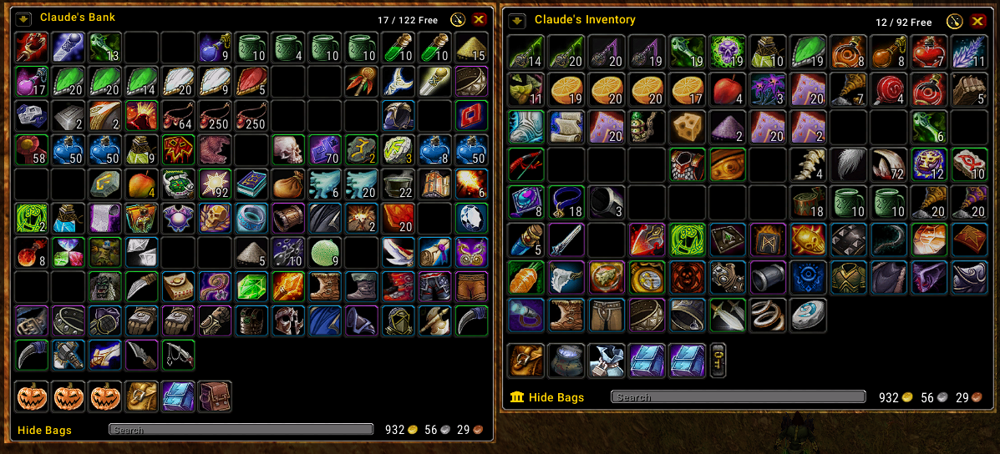

# Bagnon

One window for your bags and one for your bank, with search, native sorting and
the inventory of every character you play. For World of Warcraft 1.12.1.

Bagnon is built on the original addon by Tuller and rebuilt for
[ClassicAPI](https://github.com/brues-code/ClassicAPI): it takes its data and
events from the client's extension DLLs, does no work per frame, and keeps its
code small.

## Features

- **One bag window, one bank window.** Every bag in a single grid, with a bag bar
  you can show or hide. Drag, scale, resize the columns, change the opacity,
  layer and background colour.
- **Search.** Type in the box at the bottom of a window. Items that do not match
  are dimmed: names, types (Cloth, Bow) and slots (Head, Two-Hand).
- **Native sorting.** The broom uses ClassicAPI's sort, in either direction. The
  backpack can be left out of a sort.
- **Free space.** The header shows how many slots are free; hover it for every
  bag. Quivers, soul bags and profession bags are counted per bag.
- **Rarity borders and bag colours.** Quality borders on every item, coloured
  slots for ammo and profession bags.
- **Weapon enchant badges.** The time or charges left of a poison or oil on a
  weapon, shown on the item.
- **Your other characters.** View the bags and bank of any character on the realm
  from anywhere, see their gold, and see how many of an item they carry in its
  tooltip.
- **Opens when you need it.** Inventory at the bank and at the auction house,
  your bank in Bagnon's window.
- **Settings in one window.** `/bagnon`, or right-click a window title.
- **GearRack.** If GearRack is installed, item tooltips show the sets and the
  trinket slot that hold the item.

## Requirements

- WoW 1.12.1 (build 5875).
- [ClassicAPI](https://github.com/brues-code/ClassicAPI). Bagnon checks for it
  when it loads and tells you if it is missing.

## Installation

1. Download this repository as a ZIP (**Code**, then **Download ZIP**).
2. Extract the `Bagnon` folder into `Interface/AddOns`, so the TOC is at
   `Interface/AddOns/Bagnon/Bagnon.toc`.
3. Start the game and enable Bagnon.

## Using it

| Action | How |
| --- | --- |
| Open or close your bags | Your normal bag key, or `/bgn bags` |
| Open or close the bank, also away from a banker | `/bgn bank` |
| Search | Type in the search box at the bottom of the window; Escape clears it |
| Sort | The broom in the header, `/bgn sort`, or a key binding |
| Change the sort direction | Right-click the broom |
| Leave the backpack out of a sort | Alt-click or right-click its icon in the bag bar |
| Show or hide one bag in the grid | Shift-click its icon in the bag bar |
| View another character | The arrow left of the window title |
| Move a window | Drag its title bar or the free-space text |
| Settings | `/bagnon`, or right-click a window title |

Windows of other characters are read-only. Visit a banker to move or sort your
own bank.

### Commands

| Command | Does |
| --- | --- |
| `/bgn` | Open the settings |
| `/bgn bags` / `/bgn bank` | Toggle the inventory / the bank |
| `/bgn sort` | Sort the open window |
| `/bgn freespace` | Show or hide the free-space text |
| `/bgn enchants` | Show or hide the weapon enchant badges |
| `/bgn delete <character> <realm>` | Forget a character's saved bags |
| `/bgn help` | List the commands |

`/bagnon` and `/bo` do the same as `/bgn`. Key bindings for the inventory, the
bank and sorting are under **Key Bindings**, **Bagnon**.

See the [user guide](docs/USER_GUIDE.md) for more.

## Credits

Original Bagnon by Tuller. Maintained by McPewPew and Fostercare5988.
